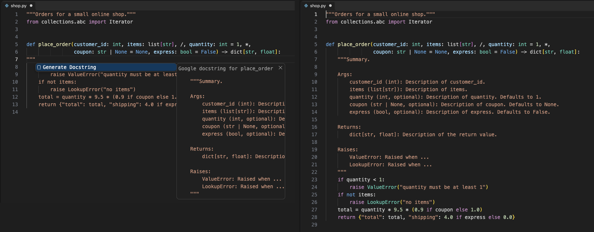
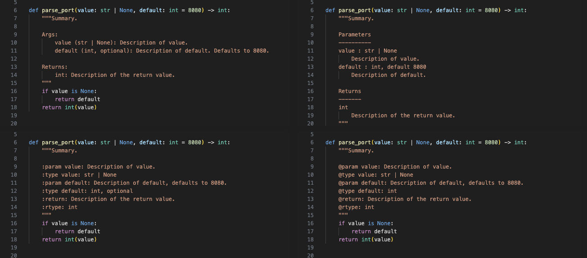

# Docstring Generator & Python Docstring Updater (Google, NumPy, Sphinx, JSDoc)



Free, no sign-in, works offline. No network calls, no telemetry, no Python install needed.

Type `"""` on the line under a `def` or `class` and press Enter. The docstring is filled from the signature: parameters, type hints, defaults, return type, what the function yields and what it raises. When you change the signature later, *Update Docstring* fixes the docstring and keeps the text you wrote.

## What you get

- Four styles and your own: Google (default), NumPy, Sphinx (reST) and Epytext, or a custom Mustache template file.
- Read from the real signature, with a bundled parser (tree-sitter), not with regular expressions:
  - type hints, including `str | None`, `list[int]` and `dict[str, list[int]]`
  - defaults (`Defaults to 2.`, `default 2`, `, optional`)
  - `*args` and `**kwargs`, positional-only `/` and keyword-only `*` parameters
  - signatures over many lines, with comments inside
  - return type, `yield` (a Yields section with the item type of `Iterator[T]`)
  - `raise X` in the body; raises inside nested functions are left out, and `raise err` in `except ValueError as err` becomes ValueError
  - `self` and `cls` skipped, `@staticmethod` kept, `@property` gets a summary only
- Classes: the `__init__` arguments go in the class docstring (not the base classes). Dataclass, attrs, pydantic and NamedTuple fields, and `self.x = ...` attributes from `__init__`, go under Attributes.
- Update Docstring, after the signature changed:
  - a renamed parameter keeps its description
  - a new parameter gets a placeholder
  - a removed parameter disappears if it only had a placeholder; if it has your text, it stays and is marked `[removed from the signature]`
  - types follow the hints; missing Returns, Yields and Raises sections are added
  - the summary, examples and notes are not touched, and each docstring keeps its own style
- Whole file: *Update All Docstrings in File* and *Add Missing Docstrings in File*. Turn on `zovoDoc.updateOnSave` to update when you save.
- Light bulb: on a `def` or `class` line, *Generate docstring* or *Update docstring (renamed a to alpha; added beta)* shows what will change.
- Module docstrings: at the top of the file, without an indent.
- Notebooks: works in the Python cells of Jupyter notebooks too.
- JSDoc for JavaScript and TypeScript: type `/**` above a function and pick *JSDoc with types*, or run *Generate JSDoc*. You get `@param {type}` from TypeScript (or from the default value in JavaScript), `[optional=default]`, destructured properties, `@returns`, `@throws {Error}`, `@yields` and `@template`. Run it again after a change to update it.
- Large files: only the function you document is parsed. In 4 real VS Code test runs on a 10,407-line file, a docstring took 0.2 to 3.2 ms, and *Update All Docstrings in File* checked all 1,735 definitions in 92 to 146 ms.

## Why this one

The most installed Python docstring extension on the Marketplace has had no release since February 2022. Its open issues ask for these things. Each row is checked in this extension's tests and in the real VS Code gate:

| What users report | Where | Here |
|---|---|---|
| No way to update a docstring after the signature changed | [#28 "Update docstring"](https://github.com/NilsJPWerner/autoDocstring/issues/28) (40 reactions), [#255](https://github.com/NilsJPWerner/autoDocstring/issues/255), [#177](https://github.com/NilsJPWerner/autoDocstring/issues/177) (renamed parameter), [#179](https://github.com/NilsJPWerner/autoDocstring/issues/179) (on save) | *Update Docstring*, *Update All Docstrings in File* and update on save. Renamed parameters keep their text, removed ones with text are kept and marked. |
| `@dataclass` classes get no fields | [#170](https://github.com/NilsJPWerner/autoDocstring/issues/170) (28 reactions) | Fields become Attributes, with type and default. `ClassVar` is left out. |
| Class docstring lists the base classes as arguments | [#246](https://github.com/NilsJPWerner/autoDocstring/issues/246) | The `__init__` arguments are listed, not the base classes. |
| No positional-only or keyword-only parameters | [#262](https://github.com/NilsJPWerner/autoDocstring/issues/262) | `/` and `*` are read; the parameters around them are all listed. |
| A triple-quoted string in the body (an SQL query) stops the docstring | [#311](https://github.com/NilsJPWerner/autoDocstring/issues/311), [#68](https://github.com/NilsJPWerner/autoDocstring/issues/68) | Works: the parser knows where strings start and end. |
| Docstring indented by a guess, which breaks the code after a signature with aligned continuation lines | [#315](https://github.com/NilsJPWerner/autoDocstring/issues/315) | The indent comes from the function body (or the line you typed on). |
| Module docstring gets an indent | [#152](https://github.com/NilsJPWerner/autoDocstring/issues/152) | No indent at the top of the file. |
| Non-ASCII names break the parameter list | [#183](https://github.com/NilsJPWerner/autoDocstring/issues/183), [#308](https://github.com/NilsJPWerner/autoDocstring/issues/308) | `größe`, `café` and `Optional[Gerät]` come out right. |

This extension is not made by, and does not replace, any other publisher's extension. If you used a custom template there, the common Mustache tags (`{{summaryPlaceholder}}`, `{{#args}}`, `{{#kwargs}}`, `{{var}}`, `{{typePlaceholder}}`, `{{descriptionPlaceholder}}`, `{{#returns}}`, `{{#exceptions}}`, `{{#yields}}`) work here too.

## Update keeps your text


## The four styles



## Commands

| Command | What it does |
|---|---|
| Docstring: Generate Docstring (Cmd+Shift+2 / Ctrl+Shift+2) | Docstring for the def or class at the cursor, or JSDoc in JS and TS |
| Docstring: Update Docstring (Signature Changed) | Brings the docstring (or JSDoc) at the cursor in line with the signature |
| Docstring: Update All Docstrings in File | The same for every docstring in the file |
| Docstring: Add Missing Docstrings in File | A docstring for every public function and class that has none |
| Docstring: Generate JSDoc | JSDoc with types for the function at the cursor |
| Docstring: Docstring Coverage Report (Workspace) | Which functions and classes have no docstring, or a stale one, in every Python file |
| Docstring: Choose Docstring Style | Google, NumPy, Sphinx, Epytext or custom |

## Settings

| Setting | Default | |
|---|---|---|
| `zovoDoc.style` | `google` | `google`, `numpy`, `sphinx`, `epytext`, `custom` |
| `zovoDoc.customTemplatePath` | | Mustache template. Relative to the workspace; `~`, `${workspaceFolder}`, `${userHome}` and `${env:NAME}` work |
| `zovoDoc.includeTypes` | `always` | `always` (hint or placeholder), `hinted` (only from hints), `never` |
| `zovoDoc.includeDefaults` | `true` | Mention default values |
| `zovoDoc.optionalMarker` | `true` | `, optional` after the type when there is a default |
| `zovoDoc.quoteStyle` | `"""` | Or `'''` |
| `zovoDoc.summaryOnNewLine` | `false` | Summary on the line after the quotes (pydocstyle D213) |
| `zovoDoc.blankLineAfterLastSection` | `false` | Blank line before the closing quotes (D413) |
| `zovoDoc.includeExtendedSummary` | `false` | Add a placeholder for a longer description |
| `zovoDoc.classInitArguments` | `class` | Document `__init__` arguments in the class docstring, or leave them to `__init__` |
| `zovoDoc.update.removedParameters` | `mark` | `mark` or `delete` removed parameters that have your text |
| `zovoDoc.updateOnSave` | `false` | Update docstrings when you save a Python file |
| `zovoDoc.generateOnTripleQuote` / `generateOnEnter` | `true` | The `"""` suggestion, and Enter when the suggestion was not picked |
| `zovoDoc.jsdoc.typesInTypeScript` | `true` | `{types}` in JSDoc in TypeScript files |

## Custom template

Set `zovoDoc.style` to `custom` and point `zovoDoc.customTemplatePath` to a file like this:

```mustache
{{summaryPlaceholder}}

{{#parametersExist}}
Args:
{{#params}}
    {{var}} ({{typePlaceholder}}): {{descriptionPlaceholder}}
{{/params}}
{{/parametersExist}}
{{#returnsExist}}

Returns:
{{#returns}}
    {{typePlaceholder}}: {{descriptionPlaceholder}}
{{/returns}}
{{/returnsExist}}
```

Lists: `params` (all), `args` (no default), `kwargs` (with default), `attributes`, `exceptions`, `returns`, `yields`. In a list: `var` (with `*` or `**`), `name`, `type`, `typePlaceholder`, `default`, `descriptionPlaceholder`. Flags: `parametersExist`, `argsExist`, `kwargsExist`, `attributesExist`, `exceptionsExist`, `returnsExist`, `yieldsExist`. Also `{{^flag}}` (when not), `{{! comments}}` and `{{&default}}`.

## Privacy

The extension never opens a network connection. The parser is bundled (tree-sitter, MIT). Nothing is collected. In Restricted Mode, a template path from the workspace settings is ignored.

## Works in

VS Code 1.90 or newer, so it also installs in Cursor, Windsurf, VSCodium and other editors built on VS Code. Tested in VS Code 1.142 with Pylance on and off, and in the Python cells of a Jupyter notebook.

## Support Zovo

Zovo extensions are free, with no ads and no tracking. They are made by [theluckystrike](https://github.com/theluckystrike) on GitHub. If this one saves you time, you can support the work:

- [Sponsor on GitHub](https://github.com/sponsors/theluckystrike)
- [PayPal](https://www.paypal.com/paypalme/najzzz)
- [Follow theluckystrike on GitHub](https://github.com/theluckystrike)

## More tools by Zovo

- [NetCDF Viewer & HDF5 Viewer (NC Viewer, H5 Viewer)](https://marketplace.visualstudio.com/items?itemName=zovo.hdf5-netcdf-explorer) browses groups, attributes and values in HDF5 and NetCDF files and plots slices.
- [Pickle Viewer & PKL Viewer (No Python)](https://marketplace.visualstudio.com/items?itemName=zovo.zovo-pickle-viewer) opens Python pickle files without Python and never runs their code.
- [NPZ Viewer & NPY Viewer, PyTorch, GGUF & Safetensors (NumPy Viewer)](https://marketplace.visualstudio.com/items?itemName=zovo.tensor-viewer) shows NPY, NPZ, Safetensors and GGUF tensors with stats and heatmaps.
- [GeoJSON Viewer, KML Viewer & GPX Viewer (Map Preview, Shapefile)](https://marketplace.visualstudio.com/items?itemName=zovo.zovo-geo-map-viewer) GeoJSON viewer, KML viewer and GPX viewer with a map preview in VS Code. Also opens shapefiles (SHP, zipped), KMZ, TopoJSON, WKT and CSV with lat/lon: feature table, properties, GPX distance and elevation profile, reprojection from .prj, PNG export. Free, no sign-in, works offline.
- [XLSX Viewer & CSV Preview for Excel, XLS & Parquet](https://marketplace.visualstudio.com/items?itemName=zovo.table-viewer-vscode) opens CSV, TSV, Excel and Parquet files as a sortable, filterable table.

See [all Zovo extensions on the Marketplace](https://marketplace.visualstudio.com/publishers/zovo).

## More from zovo

- [All free zovo VS Code extensions](https://marketplace.visualstudio.com/publishers/zovo) — file viewers, database clients, formatters. Offline, no telemetry, no sign-up.
- [Full MCP server catalogue](https://theluckystrike.github.io/mcp/) — local-first MCP servers for back-office work: invoices, VAT, PDFs, spreadsheets, payroll.
- [Hosted no-install MCP endpoints](https://mcp.zovo.one) — paste a URL in Claude / Cursor, nothing to install.
